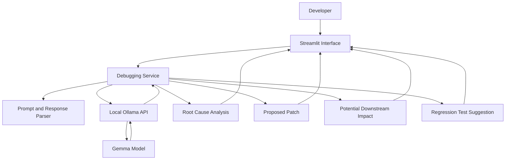

# SlothFix

**Debug smarter. Ship safer.**

SlothFix is a local-first AI debugging assistant that helps developers understand errors, explore minimal fixes, and identify potential side effects before changing their code.

It uses Google's Gemma models through Ollama, allowing analysis to run locally instead of sending code to a cloud-based AI service. SlothFix also generates regression test suggestions to help developers check that a proposed fix addresses the original issue.

## Why SlothFix?

Debugging is more than finding the line that caused an error. A quick fix can introduce new bugs, break calling functions, or create problems that only appear later.

SlothFix aims to make that process more deliberate by bringing the diagnosis, proposed fix, potential impact, and regression testing into one workflow.

It is designed for developers who want AI-assisted debugging while keeping their source code on their own machine.

## Features

- **Root cause analysis:** Explains the likely cause of an error and the code behavior behind it.
- **Minimal patches:** Suggests a focused correction rather than rewriting unrelated parts of the code.
- **Patch comparison:** Helps developers compare the original code with the proposed fix.
- **Butterfly Effect analysis:** Highlights possible downstream consequences, from immediate failures to caller issues and potential data integrity risks.
- **Regression test generation:** Suggests tests that can help prevent the same bug from returning.
- **Multiple languages:** Provides a language selector for Python, JavaScript, TypeScript, Go, Rust, Java, C++, SQL, and Bash.
- **Example bug presets:** Includes sample scenarios for common mistakes, making it easier to try the workflow.
- **Local model integration:** Connects to models installed in Ollama without requiring a cloud AI API key.

AI-generated explanations, patches, and tests are suggestions. They should be reviewed and validated by a developer before being used in a real project.

## How it works

1. Enter the code that is causing the problem and provide the associated error or unexpected behavior.
2. SlothFix sends the debugging request to a locally running Ollama model.
3. The model generates a diagnosis, a proposed patch, an assessment of possible downstream effects, and a regression test suggestion.
4. Review the results and decide which changes, if any, to apply.

SlothFix is designed to generate suggestions rather than execute submitted code or generated tests automatically.

## Architecture



The application is organized into separate modules for the interface, debugging service, Ollama integration, prompt construction, and response parsing. This keeps the model interaction separate from the UI and makes individual components easier to test.

## Tech stack

- **Python** — application logic
- **Streamlit** — web interface
- **Ollama** — local model runtime
- **Google Gemma** — local language model
- **pytest** — automated tests

## Requirements

Before running SlothFix, make sure you have:

- Python installed
- [Ollama](https://ollama.com/) installed and running
- A Gemma model downloaded in Ollama
- The project source code on your machine

Check which models are installed:

```bash
ollama list
```

If you do not have a suitable Gemma model, download one using a model tag supported by your Ollama installation. For example:

```bash
ollama pull gemma3:4b
```

Model availability and resource requirements vary by model and machine. Use a model tag that your SlothFix configuration supports.

## Installation

Clone the repository and enter the project directory:

```bash
git clone https://github.com/nikkisbhandari123-coder/slothfix.git
cd slothfix
```

Create and activate a virtual environment (recommended).

**Windows PowerShell:**

```powershell
python -m venv .venv
.\.venv\Scripts\Activate.ps1
```

Install the dependencies:

```bash
python -m pip install -r requirements.txt
```

Make sure Ollama is running and that the required model is available locally.

## Run the application

Start SlothFix with:

```bash
python -m streamlit run app.py
```

Streamlit will print the local URL in your terminal. Open that address in your browser to use the application.

## Run the tests

From the project root, run:

```bash
python -m pytest tests
```

The current test suite has passed **13 tests** in the development environment. These tests cover the debugging service and response parsing; this result does not mean every AI-generated patch or test has been validated.

## Safety and privacy

SlothFix is designed around local inference and conservative handling of submitted code.

- **Local inference:** Model requests are sent to the locally running Ollama service.
- **No automatic code execution:** Submitted code and generated tests are intended to be analyzed or displayed, not executed by SlothFix.
- **Human review:** Suggested changes may be incomplete or incorrect and should be checked before use.
- **Offline use:** After installation and model download, the application can be used without cloud inference, provided its dependencies and local model are available.

Local inference does not make a machine automatically secure. Keep Ollama and other local services properly configured, and avoid exposing them to untrusted networks.

## Limitations

- Results depend on the model, the supplied code, and the quality of the error description.
- Downstream impact analysis is an estimate, not a guarantee that every affected component has been identified.
- A suggested patch may need changes to fit the surrounding codebase.
- Generated regression tests should be reviewed and run separately in an appropriate test environment.
- SlothFix does not replace code review, a full test suite, static analysis, or production monitoring.

## Project structure

```text
slothfix/
├── app.py
├── components/
│   ├── header.py
│   ├── input_panel.py
│   ├── results_panel.py
│   └── styles.py
├── services/
│   ├── debugger.py
│   └── ollama_client.py
├── utils/
│   ├── prompts.py
│   └── response_parser.py
├── tests/
│   ├── test_debugger.py
│   └── test_response_parser.py
├── requirements.txt
└── README.md
```

## Contributing

Contributions and suggestions are welcome. If you find a bug or want to improve the debugging workflow, open an issue describing the problem and, where possible, include a minimal reproducible example.

When contributing, avoid including API keys, credentials, private source code, or local model files in commits.

## License

No license has been specified yet. If you plan to publish SlothFix as an open-source project, add a `LICENSE` file that matches the permissions you want to grant others.

---

Built to make debugging a little more thoughtful, one fix at a time.