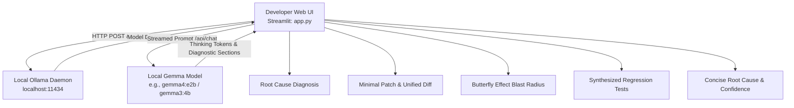

# SlothFix 🦥

> **The Local-First AI Debugging & Blast-Radius Assistant**  
> *Debug methodically so your software runs fast. 100% on-device inference via Gemma and Ollama. Zero cloud dependencies, zero IP leakage.*

---

## 🎯 Problem & Hackathon Pitch

Every day, developers lose valuable engineering hours deciphering cryptic stack traces, applying hasty fixes that introduce regressions, and missing the subtle downstream "butterfly effects" that trigger cascading production outages.

At the same time, copying proprietary enterprise codebase snippets into cloud-hosted LLM endpoints poses severe security, compliance, and privacy risks.

**SlothFix 🦥** solves both challenges with a local-first, privacy-guaranteed debugging workflow:
1. **100% Local Inference**: Runs directly on your machine using Google's **Gemma** model via the **Ollama** HTTP API. No internet access or cloud API keys required.
2. **Root Cause Analysis**: Pinpoints exact interpreter and runtime mechanics behind the bug.
3. **Minimal Clean Patch**: Generates the smallest surgical fix alongside a side-by-side view and git-style unified diff.
4. **The Butterfly Effect Panel**: Visualizes the 3-level blast radius of the bug (Immediate Crash $\rightarrow$ Caller Cascades $\rightarrow$ Silent Data/System Risks).
5. **Auto-Generated Regression Tests**: Synthesizes ready-to-commit unit tests (pytest, Jest, etc.) to permanently lock in the fix.
6. **Host-Safe Architecture**: Employs static synthesis only. Arbitrary submitted code is **never** executed directly on your host machine.

---

## 🏗️ Architecture



---

## 🌟 Key Features

| Feature | Description |
| :--- | :--- |
| **Model Auto-Detection** | Queries Ollama's `/api/tags` endpoint dynamically, auto-detecting and prioritizing installed Gemma models (`gemma4:e2b`, `gemma3:4b`). |
| **Multi-Language Selector** | First-class support for Python, JavaScript, TypeScript, Go, Rust, Java, C++, SQL, and Bash. |
| **Side-by-Side Patch & Diff** | Displays original buggy code, SlothFix corrected code, and an interactive colored unified git diff. |
| **Butterfly Effect Panel** | 3-stage impact assessment: Level 1 (Crash site), Level 2 (Caller/API 500s), Level 3 (Data corruption & retry storms). |
| **Regression Test Generator** | Emits copy-paste ready test cases (pytest / unittest / jest) covering the edge case. |
| **Concise Diagnosis Engine** | Distills complex runtime and interpreter mechanics into an actionable, high-signal explanation. |
| **One-Click Presets** | Instant pre-loaded bug demonstrations for Python `NoneType`, JavaScript `undefined .map()`, and Off-by-One Loop errors. |
| **Strict Host Protection** | All fixes and tests are statically generated suggestions; host execution is disabled by design. |

---

## 🚀 Quickstart & Exact Terminal Commands

### 1. Prerequisites
Ensure Ollama is installed and running with a Gemma model:
```bash
# Verify Ollama is running
ollama list

# If Gemma is not yet installed:
ollama run gemma4:e2b
```

### 2. Install Python Dependencies
```bash
cd c:\Users\nikki\slothfix
pip install -r requirements.txt
```

### 3. Launch SlothFix
```bash
python -m streamlit run app.py
```
*The app will automatically open in your default browser at `http://localhost:8501`.*

---

## 📋 Hackathon Demo Checklist

Follow this 2-minute walkthrough during your hackathon demo:

- [ ] **1. Show Local-First Connectivity**:
  - Point out the green **"● Ollama Engine Connected"** badge in the sidebar.
  - Show the auto-detected model tag (`gemma4:e2b`) and model specifications (parameter size, quantization, local RAM/VRAM runner).
- [ ] **2. Run Preset 1: Python NoneType Error**:
  - Click the **`🐍 Python NoneType Error`** preset button.
  - Hit **`🦥 Analyze & Debug with Gemma`**.
  - Show the live thinking token stream and completion timer.
- [ ] **3. Inspect the Minimal Patch & Diff**:
  - Switch to the **Minimal Patch & Diff** tab.
  - Highlight the side-by-side original vs. corrected code and the color-coded unified diff.
- [ ] **4. Highlight the Butterfly Effect**:
  - Switch to the **Butterfly Effect** tab.
  - Explain how SlothFix warns developers of Level 2 (Caller API 500s) and Level 3 (corrupted DB transactions/retry storms) before code reaches staging.
- [ ] **5. Showcase the Regression Test**:
  - Show the ready-to-copy `pytest` regression test preventing future regressions.
- [ ] **6. Inspect Concise Root Cause & Confidence**:
  - Review the concise interpreter mechanics explanation and model confidence assessment.
- [ ] **7. Test JavaScript Preset**:
  - Click **`🌐 JS undefined .map() Error`** to demonstrate multi-language versatility.

---

## 🛡️ Safety & Host Protection

SlothFix adheres to strict security principles:
- **No Direct Execution**: User-submitted code and generated tests are never executed on the host runtime.
- **Zero Third-Party APIs**: No external telemetry, tracking, or cloud AI endpoints. All HTTP requests are strictly bound to `http://localhost:11434`.
- **Air-Gap Ready**: Works completely offline once model weights are stored in Ollama.

---

*Crafted with 🦥 care for local-first AI builders.*
